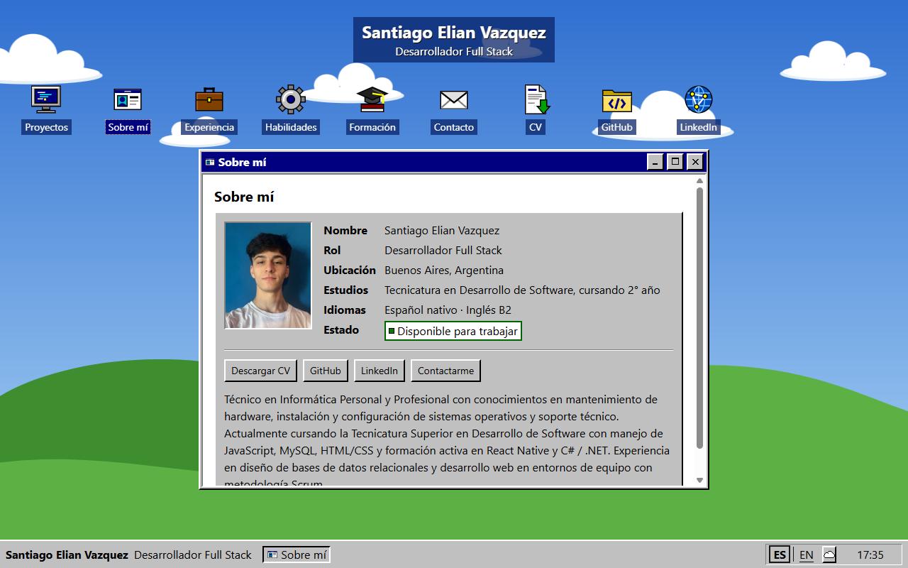

# Santiago Elian Vazquez — Portafolio

**Desarrollador Full Stack** · Buenos Aires, Argentina · [English below](#english)

Mi portafolio personal, con forma de escritorio de Windows 95: íconos, ventanas que se mueven y se minimizan, barra de tareas y un fondo en pixel art con nubes. Cada sección es una ventana: proyectos, experiencia, formación, habilidades y contacto.

**🔗 Verlo en vivo: [santiago-vazquez-portfolio.vercel.app](https://santiago-vazquez-portfolio.vercel.app)**



## Qué hay adentro

- **Gestor de ventanas propio:** varias ventanas a la vez, traer al frente, arrastrar, minimizar a la barra de tareas, maximizar y cerrar. Hecho desde cero, sin librerías de interfaz.
- **Habilidades con rebote estilo DVD:** los logos flotan, rebotan y chocan entre sí con física propia, y se pueden agarrar y soltar con mouse o dedo.
- **Formulario de contacto real:** se valida y se envía desde el servidor con [Resend](https://resend.com). Tiene campo trampa contra bots y límite de intentos.
- **Bilingüe español / inglés**, con diccionarios propios sin librería y un test que garantiza que los dos idiomas tengan los mismos textos.
- **Accesible:** se usa entero con teclado y lector de pantalla, con contraste AA. Respeta `prefers-reduced-motion` y las animaciones se pueden pausar.
- **Adaptable:** en el celular cada ventana ocupa la pantalla completa.
- **Arte propio:** íconos, fondo, cursores y favicon dibujados a mano en SVG.

## Tecnologías

| Área | Herramientas |
| --- | --- |
| Frontend | Next.js 16 (App Router), React 19, TypeScript estricto, Tailwind CSS 4, Motion |
| Backend | Ruta de API de Next (`POST /api/contact`) + Resend |
| Calidad | Vitest (más de 2100 tests), ESLint con reglas propias, Prettier |
| Despliegue | Vercel |

## Cómo está hecho

- La lógica (ventanas, física del rebote, navegación, validaciones) vive en `src/lib/` como funciones puras sin React, así se prueba con tests rápidos y deterministas.
- Los componentes de `src/components/` solo dibujan y delegan eventos.
- Los textos de la interfaz y el contenido están separados del código (`src/i18n/` y `src/content/`). Para sumar un proyecto o un trabajo alcanza con editar datos.
- Una regla de ESLint propia (`lint/`) impide escribir texto visible a mano en un componente, para que todo pase por los dos idiomas.

## Correrlo en local

Requiere Node 24 y npm.

```bash
npm install
npm run dev
```

El sitio funciona sin configuración. Para que el formulario envíe emails de verdad, copiá `.env.example` a `.env.local` y completá `RESEND_API_KEY` y `CONTACT_TO_EMAIL`.

| Comando | Qué hace |
| --- | --- |
| `npm run test` | Tests de Vitest |
| `npm run lint` | ESLint |
| `npx tsc --noEmit` | Chequeo de tipos |
| `npm run build` | Build de producción |

## Contacto

- [LinkedIn](https://www.linkedin.com/in/santiagoelianvazquez/)
- [CV en PDF](public/CV_SantiagoElianVazquez.pdf)
- O desde la ventana **Contacto** del sitio.

---

## English

**Full Stack Developer** · Buenos Aires, Argentina

My personal portfolio, built as a Windows 95 desktop: icons, draggable and minimizable windows, a taskbar and a pixel-art cloudy wallpaper. Each section is a window: projects, experience, education, skills and contact.

**🔗 Live: [santiago-vazquez-portfolio.vercel.app](https://santiago-vazquez-portfolio.vercel.app)**

### Highlights

- **Custom window manager** built from scratch: multiple windows, focus, drag, minimize to the taskbar, maximize and close, with no UI library.
- **DVD-style bouncing skills:** logos float, bounce and collide with hand-written physics, and can be dragged with mouse or touch.
- **Working contact form:** validated and sent server-side through Resend, with a honeypot and rate limiting.
- **Bilingual (Spanish / English)** with in-house dictionaries and a parity test between both languages.
- **Accessible:** full keyboard and screen reader support, AA contrast, `prefers-reduced-motion` and pausable animations.
- **Responsive:** windows go full screen on mobile.
- **Original art:** icons, wallpaper, cursors and favicon hand-drawn as SVG.

### Stack

Next.js 16 (App Router) · React 19 · strict TypeScript · Tailwind CSS 4 · Motion · Resend · Vitest (2100+ tests) · ESLint · Prettier · Vercel.

Core logic (windows, physics, navigation, validation) lives in `src/lib/` as pure, framework-free functions covered by fast deterministic tests. UI copy and content are kept apart from the components (`src/i18n/`, `src/content/`).

### Run locally

Requires Node 24 and npm: `npm install` and then `npm run dev`. To send real emails, copy `.env.example` to `.env.local` and set `RESEND_API_KEY` and `CONTACT_TO_EMAIL`.

---

Los logos de tecnologías son de [Simple Icons](https://simpleicons.org) (CC0). JavaScript, PHP y Git tienen su licencia y sus créditos en [`public/skills/LICENSES.md`](public/skills/LICENSES.md). / Technology logos from Simple Icons (CC0); attribution for JavaScript, PHP and Git in that file.
